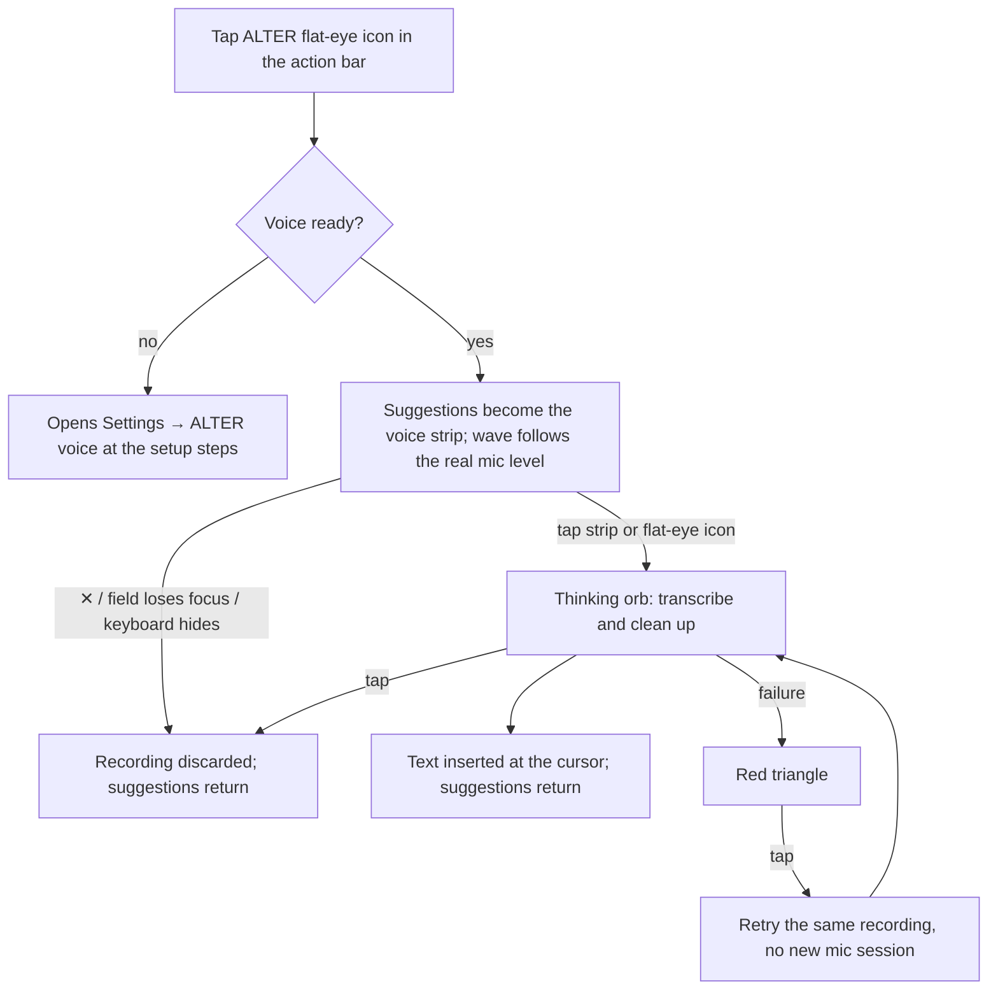
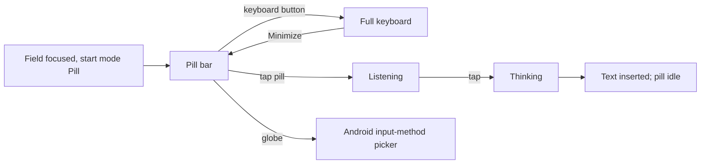

# ALTER Keyboard: sitemap and user flows

How the app is organised and how people move through it. The structure follows the UI/UX Pro Max review
(github.com/nextlevelbuilder/ui-ux-pro-max-skill, `ux` guidelines): primary task first, progressive disclosure,
grouped navigation with a predictable back, empty states with one clear next step, and 48 dp Android touch targets.

## Sitemap

```
Android launcher: ALTER Keyboard icon
└── Settings home
    ├── [Set up ALTER voice] card ............ only until voice works; one "Set up voice" button
    ├── [Payment reminder] ................... when shown by the upstream payment logic (license requirement)
    ├── Voice
    │   └── ALTER voice ...................... subtitle: "Ready · <model>" or the missing step
    │       ├── Set up ALTER voice ........... only while something is missing
    │       │   ├── 1 Allow the microphone ... [Allow]
    │       │   └── 2 Download <recommended> . [Download], progress, used as soon as it finishes
    │       ├── Speech ....................... model in use · Dictation language
    │       │   └── All speech models (n) .... collapsed: Moonshine, Whisper, device recognition; download/use/delete
    │       ├── Keyboard ..................... Start mode (Full / Pill) · End recording after silence
    │       ├── Dictation cleanup ............ switch · LFM2.5 model download/delete
    │       └── Storage used
    ├── Typing
    │   ├── Languages
    │   ├── Keyboard & typing
    │   ├── Swipe typing
    │   └── Predictive text
    ├── Look & feel
    │   ├── Themes ........................... ALTER theme is the default; other themes stay
    │   └── Actions .......................... toolbar actions (ALTER flat-eye voice icon, Minimize, undo, clipboard, …)
    └── More
        ├── Help ............................. version, attribution line (last item)
        ├── Payment .......................... upstream payment page, until paid (license requirement)
        ├── Miscellaneous
        ├── Credits
        └── Developer ........................ only in developer mode
Search (top right of the home) reaches every setting by name.
```

The keyboard itself has two surfaces:

```
Text field focused
├── Full keyboard (default start mode)
│   ├── Action bar: expand · suggestions · pinned actions (Minimize, ALTER flat-eye voice icon)
│   │   └── ALTER flat-eye icon → suggestion row becomes ALTER's voice strip (✕ + pill); keys stay
│   └── Keys
└── Pill mode (start mode "Pill", or Minimize)
    └── 56 dp bar: globe (switch input method) · pill · keyboard button (back to full keyboard)
Password / no-personalized-learning field → always the full keyboard, mic disabled
```

## User flows

### First run

```mermaid
flowchart TD
    A[Install APK from Releases] --> B[Open ALTER Keyboard]
    B --> C[Setup: enable ALTER Keyboard in Android]
    C --> D[Setup: select it as the input method]
    D --> E[Settings home]
    E --> F{Voice ready?}
    F -- no --> G["Set up ALTER voice" card]
    G --> H[ALTER voice: step 1 Allow microphone]
    H --> I[Step 2 Download recommended model]
    I --> J[Model used automatically when the download ends]
    J --> K[Card disappears; home shows "Ready · model"]
    F -- yes --> K
```

### Dictating in the full keyboard



### Pill mode



## UX rules applied (and where)

| Rule (UI/UX Pro Max `ux`) | Where |
| --- | --- |
| Primary task first, visual hierarchy | Voice group first on the home; setup card above everything else until voice works |
| Progressive disclosure | All speech models collapsed behind "All speech models"; setup steps only while needed |
| Empty state with guidance | "Set up ALTER voice" card and the voice row's status subtitle name the missing step |
| Remove needless steps | A finished download is used automatically when no model is chosen yet |
| Grouped navigation, predictable back | Four labelled home groups; one back arrow left of every page title |
| Multi-step progress | Numbered step badges that turn yellow with a check when done |
| Touch targets 48 dp, 8 dp spacing | Rows, buttons, pill bar buttons and the voice strip's ✕ |
| Don't send users to wrong destinations | FUTO's "check for updates" item removed from the home (ALTER builds come from Releases) |
