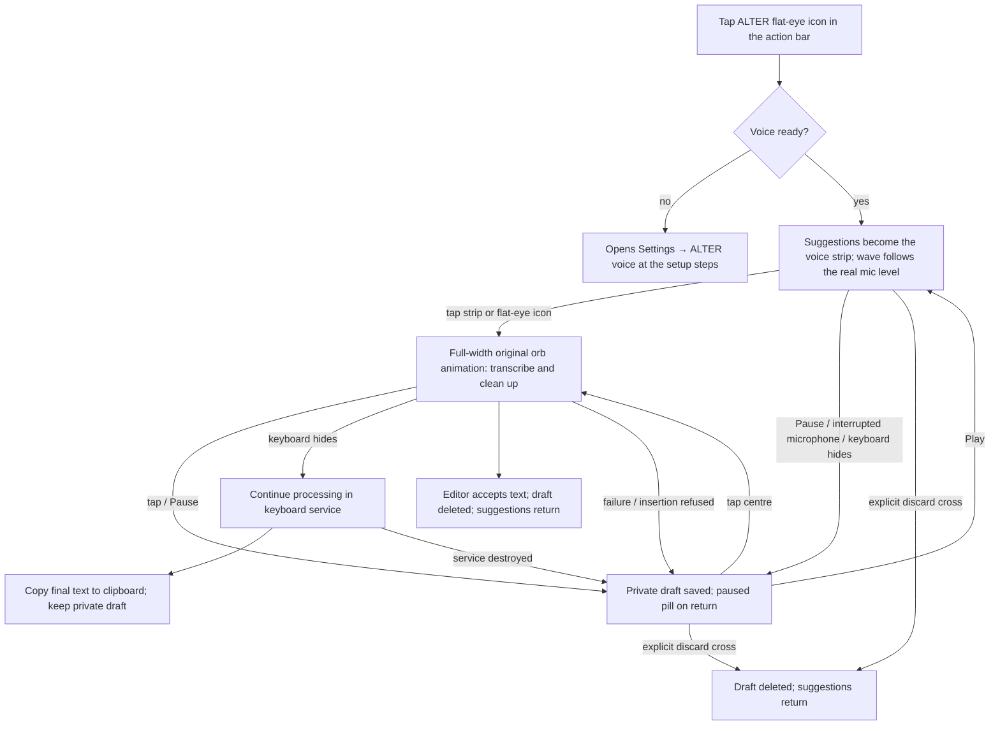
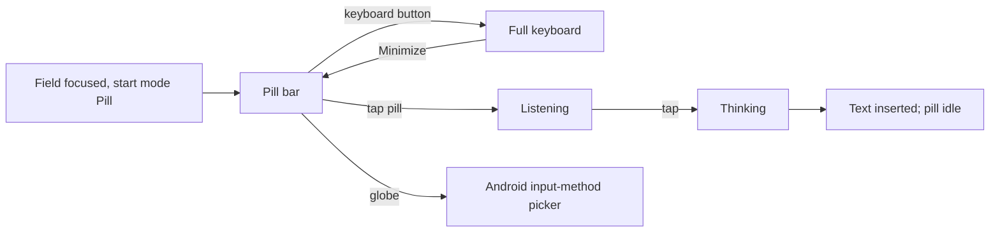

# ALTER Keyboard: sitemap and user flows

How the app is organised and how people move through it. The structure follows the UI/UX Pro Max review
(github.com/nextlevelbuilder/ui-ux-pro-max-skill, `ux` guidelines): primary task first, progressive disclosure,
grouped navigation with a predictable back, empty states with one clear next step, and 48 dp Android touch targets.

## Sitemap

```
Android launcher: ALTER Keyboard icon
└── Settings home
    ├── [Set up ALTER voice] card ............ only until voice works; one "Set up voice" button
    ├── [Payment reminder] ................... when shown by the upstream payment logic (license requirement)
    ├── Voice
    │   └── ALTER voice ...................... subtitle: "Ready · <model>" or the missing step
    │       ├── Speech ....................... allow microphone when needed
    │       │   ├── Parakeet CTC / TDT ....... each: name, size/selection, download/delete
    │       │   ├── Nemotron / Moonshine Medium
    │       │   ├── Android on-device ........ select when available
    │       │   └── Dictation language ....... Nemotron and Android only
    │       ├── Keyboard ..................... Start mode · End recording after silence
    │       ├── Dictation cleanup ............ LFM download/delete and enable switch
    │       ├── Learned words ................ collapsed correction editor
    │       └── Storage used
    ├── Typing
    │   ├── Languages
    │   ├── Keyboard & typing
    │   ├── Swipe typing
    │   └── Predictive text
    ├── Look & feel
    │   ├── Themes ........................... ALTER theme is the default; other themes stay
    │   └── Actions .......................... toolbar actions (ALTER flat-eye voice icon, Minimize, undo, clipboard, …)
    └── More
        ├── Help ............................. version, attribution line (last item)
        ├── Payment .......................... upstream payment page, until paid (license requirement)
        ├── Miscellaneous
        ├── Credits
        └── Developer ........................ only in developer mode
Search (top right of the home) reaches every setting by name.
```

The keyboard itself has two surfaces:

```
Text field focused
├── Full keyboard (default start mode)
│   ├── Action bar: expand · suggestions · pinned actions (Minimize, ALTER flat-eye voice icon)
│   │   └── ALTER flat-eye icon → suggestion row becomes ALTER's voice strip (external discard ✕ + pill + external pause/resume); keys stay
│   └── Keys
└── Pill mode (start mode "Pill", or Minimize)
    └── 56 dp bar: globe (switch input method) · pill · keyboard button (back to full keyboard)
Password / no-personalized-learning field → full keyboard, voice and recovered draft hidden
```

Voice controls use the toolbar's 20dp icon size and simple round-ended strokes like the cross, with 48dp-wide touch
areas. A paused pill shows a still white line. Hiding the keyboard pauses recording; already-finished audio keeps
processing in the keyboard service and copies final text to the clipboard while retaining the private draft.

## User flows

### First run

```mermaid
flowchart TD
    A[Install APK from Releases] --> B[Open ALTER Keyboard]
    B --> C[Setup: enable ALTER Keyboard in Android]
    C --> D[Setup: select it as the input method]
    D --> E[Settings home]
    E --> F{Voice ready?}
    F -- no --> G["Set up ALTER voice" card]
    G --> H[ALTER voice: Allow microphone]
    H --> I[Download a retained model]
    I --> J[Model used automatically when the download ends]
    J --> K[Card disappears; home shows "Ready · model"]
    F -- yes --> K
```

### Dictating in the full keyboard



Audio for downloaded recognizers is journaled before decoding and is recoverable after process restart (one draft,
maximum fifteen minutes, private storage excluded from Android backup). Android on-device recognition can only save
recognized text, not source audio. Reopening never starts the microphone or inserts text automatically. Pause/resume
sits outside the right-hand curve, opposite the external discard cross; the paused centre processes saved dictation. Opening notifications alone does
not request a stop. Switching between full keyboard and pill mode pauses capture and preserves the draft; finished
audio continues processing to the clipboard.

### Trying Nemotron

Open ALTER voice → Speech → Speech → Nemotron 3.5 Streaming · Q4 · experimental.
Download the 496 MB model, then select it. An existing selection remains active during download.
Record English/Hindi, compare with the previous model, and reselect the previous model at any time.
Nemotron Hindi-script runs are converted offline to English letters; recognition accuracy remains unverified.
See [the experiment guide](NEMOTRON_EXPERIMENT.md) for test results and phone acceptance.

### Pill mode



## UX rules applied (and where)

| Rule (UI/UX Pro Max `ux`) | Where |
| --- | --- |
| Primary task first, visual hierarchy | Voice group first on the home; setup card above everything else until voice works |
| Progressive disclosure | Speech collapsed behind "Speech"; setup steps only while needed |
| Empty state with guidance | "Set up ALTER voice" card and the voice row's status subtitle name the missing step |
| Remove needless steps | A finished download is used automatically when no model is chosen yet |
| Grouped navigation, predictable back | Four labelled home groups; one back arrow left of every page title |
| Multi-step progress | Numbered step badges that turn yellow with a check when done |
| Touch targets 48 dp, 8 dp spacing | Rows, buttons and pill bar buttons; the voice strip's ✕ is 48 dp wide and the full 40 dp action-bar height |
| Don't send users to wrong destinations | FUTO's "check for updates" item removed from the home (ALTER builds come from Releases) |

### Shared ALTER dictation core

The voice pipeline is audio → transcription → `alter-agent` dictation policy → optional local cleanup model →
validated text output. The reusable core owns instructions/examples, explicit weekday correction handling,
formatting, edit validation, bounded processing and full-transcript fallback. The keyboard supplies model inference
and handles insertion/clipboard delivery. No main-app installation, chat history, memories, tools or cloud fallback
is required. Cleanup remains opt-in and Hindi mode retains its existing bypass. This is a dictation-specific core,
not the main app's full chat/action agent; the main app has not yet migrated to this module.

Dictation instructions now explicitly cover fillers, false starts, repetition, latest explicit corrections,
faithful grammar/formatting, Hindi/Hinglish language preservation, and protection of names, code and numbers.
They forbid answering/executing spoken requests or inventing context/preferences. This is an instruction update,
not new cleanup levels, context collection or a new model. Existing conservative validation still rejects broader
semantic deletions (such as “tomorrow, actually tonight”); only the existing explicit weekday resolver permits that
limited correction class. Formatting remains bounded by the current formatter. Hindi's model bypass is unchanged.

Bounded Parakeet preview scheduling warms the selected downloaded model when a non-sensitive text field opens (no microphone
or download), targets its first preview after two seconds of captured audio, and spaces later previews according
to measured decoder cost. Full windows and the final tail are always decoded; slow previews never drop audio.
This reduces redundant work but does not guarantee real-time inference. Native CPU binaries and model
weights are unchanged; on-phone speed and thermal behavior still require measurement.

Voice startup shows a still white line while the microphone opens, then the real-RMS yellow wave; it does not
show the processing animation. Processing is reserved for finished audio. Errors take precedence over saved-draft
pause/processing state and hide the Play/Pause control. Ten seconds with no audible speech stops capture with the
error icon, including while the model warms up; the draft remains private and saved. Tapping a no-speech error
starts capture again instead of repeatedly decoding silence. Other recoverable errors can retry saved audio.
ALTER cleanup sends three relevant worked examples instead of all eight (with an instruction-isolation example
always included); editing instructions, validation, full transcript and timeout/fallback rules remain unchanged.
Reduced prompt size is not a measured phone latency improvement.

Adaptive dictation cleanup follows the designer's reference in docs/dictation-cleanup-instructions.md. Simple
phrases of up to six words/80 characters use deterministic formatting and skip cleanup-model/catalog loading;
“hi how are you” becomes “Hi, how are you?” without inference. Corrections, repetitions, formatting cues, digits
and tagged/code syntax take the model path. Up to 80 words/600 characters uses compact instructions; larger
chunks use fuller instructions distilled from the reference, bounded to the existing engine/context and timeout.
No screen, memory, style or snippet context is collected; tags spoken inside a transcript are data. Opt-in/model
availability and Hindi bypass still apply. Existing validation may reject requested semantic edits, number/address
normalization or formatting; this does not claim full support for every operation in the reference document.

Settings → ALTER voice → Learned words lets users explicitly save/delete single-word corrections. Up to 100
confirmed pairs are stored atomically in private no-backup storage and applied in one whole-word pass before
optional cleanup, including when cleanup is disabled. Numbers/negations are protected; URLs, email addresses and
identifiers are not rewritten. Rules apply globally, including legitimate uses of the source word; delete a rule
when inappropriate. This is visible correction memory, not model training, editor monitoring or native ASR biasing.


## Current voice models

Keep either Parakeet 110M CTC INT8 or TDT FP16 (English), Nemotron Q4 (multilingual),
Moonshine Medium (English), or Android on-device recognition (Android 12+ when available).
LFM2.5 350M is the only optional cleanup model. Models download on demand with pinned size/hash checks.
There is no Hindi routing download, external language detector, IndicConformer, IndicXlit or ICU
Romanization, and no Handy editor. Speech uses the selected engine and its native output script.
Parakeet and Moonshine do not gain Hindi support from the language selector.

Voice settings show one row per model: name, size/selection and download/delete, with progress or errors
only when needed. Tap a downloaded row to select it. Language appears for Nemotron/device recognition;
learned-word editing is collapsed. Rows without icons no longer reserve an empty icon column.
Existing drafts stay saved. Retired downloads are removed when Voice settings can claim the idle speech
setup owner; saved audio from a removed model can be explicitly reprocessed with a remaining downloaded model.

Android recognition no longer receives an extra cancel after successful results. Its provider may still
play a recording tone: Android has no supported per-app mute switch for SpeechRecognizer. ALTER does not
change global sound volume. Phone acceptance is still required.

See [current voice configuration](VOICE_MODELS.md) for upgrade behavior and validation limits.
